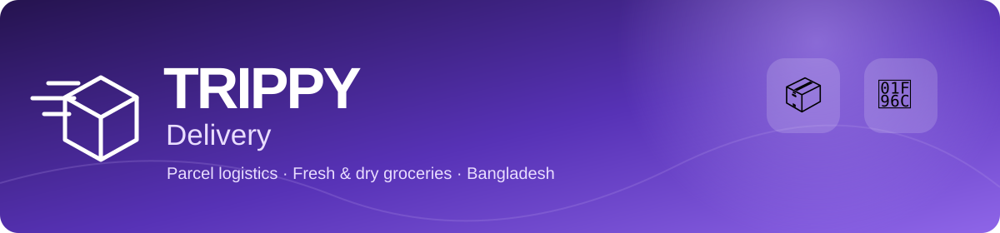

  
  <h1>TRIPPY Delivery</h1>
  
<strong>One platform. Two dedicated delivery ecosystems.</strong>

  
Parcel logistics · First-party fresh and dry groceries · Dhaka-first, nationwide-ready

  

    <a href="#quick-start">Quick start</a> ·
    <a href="docs/ARCHITECTURE.md">Architecture</a> ·
    <a href="docs/ROADMAP.md">Roadmap</a> ·
    <a href="CONTRIBUTING.md">Contributing</a> ·
    <a href="docs/PRODUCTION_READINESS.md">Launch gates</a>
  

---

> **Status: engineering foundation / development preview. NOT approved for live customer orders.**
> Dedicated Google Cloud project created: `trippy-delivery-2026` (currently not billed or deployed). Cloudflare Pages remains unprovisioned; see the [deployment plan](docs/DEPLOYMENT.md).
> The repository contains working domain API foundations and a web preview. Live maps/traffic, courier verification, payments, slot capacity, warehouse processes and operations controls are not yet integrated. Never claim the system is production-launched.

## Product vision

**TRIPPY Delivery** is a Bangladesh-focused logistics and grocery service built as a modular system for all 64 districts, beginning with **Dhaka as the first operational market**. Users see two independent services in one application:

| | 📦 Parcel Delivery | 🥬 TRIPPY Groceries |
| --- | --- | --- |
| Core business | Customer-to-customer and merchant parcels | TRIPPY-owned stock; TRIPPY is the main vendor |
| Geography | Dhaka first; intercity/village routes later | Dhaka delivery zones first |
| Pricing | Dimensions, actual/volumetric weight, route distance; eventually live traffic/capacity | Product unit, quantity, processing options, delivery window |
| Supply | Verified independent delivery partners and logistics carriers | Fresh procurement, dry goods, warehouses and quality control |
| Operations | Pickup → scan → dispatch → delivery verification | Order → inventory reserve → prep/pack → slot dispatch → proof of delivery |
| Target SLA | Same city ≤24h; active intercity routes 3–5 days | Before 13:00: today by 21:00; 13:00–21:00: tomorrow by 09:00; after 21:00: tomorrow by 21:00 |

**Fresh and dry are separate grocery categories.** In Fresh, customers choose raw/whole or cleaning/cutting preparation (where suitable). Dry includes rice, dal, flour, oil, spices, packaged foods and household items. **Food delivery is not the parcel platform's focus.**

## Architecture at a glance

~~~mermaid
flowchart TB
    User["Customer / Merchant"] --> Web["Next.js Web Application"]
    Web --> API["FastAPI API · /api/v1"]
    API --> Auth["JWT / Authorization"]
    API --> Parcels["Parcel Domain"]
    API --> Groceries["Grocery Domain"]
    API --> Locations["Serviceability"]
    Parcels --> Pricing["Quote + Parcel Lifecycle"]
    Groceries --> Stock["Product + Inventory + Checkout"]
    Parcels --> Audit["Audit Domain"]
    Groceries --> Audit
    Pricing --> Postgres[("PostgreSQL")]
    Stock --> Postgres
    Audit --> Postgres
    API --> Logs["Structured Application Logs"]
    style Parcels fill:#ece5ff,stroke:#714ce3,color:#28174e
    style Groceries fill:#e4f7e9,stroke:#279957,color:#153a22
~~~

The platform is **not** a single file containing unrelated business rules. Domains own their models, validation, routes and behavior. Infrastructure stays outside domain code.

## Repository layout and ownership

~~~text
Trippy-Delivery-/
├── apps/
│   └── web/                  # Next.js presentation; parcel/grocery features separated
├── services/
│   └── api/
│       ├── app/
│       │   ├── core/          # auth, configuration, DB access, structured request logs
│       │   └── modules/
│       │       ├── parcels/   # quotes, bookings, tracking events
│       │       ├── groceries/ # products, inventory, cart checkout, schedule
│       │       ├── couriers/  # partner verification model (approval workflow pending)
│       │       ├── locations/ # route/serviceability controls
│       │       └── audit/     # transactional audit records
│       ├── alembic/          # authoritative versioned database migrations
│       ├── scripts/          # local-only catalog seeding
│       └── tests/            # domain rule tests
├── database/                # data architecture and migration ownership
├── infra/                   # operations/observability planning
├── docs/                    # architecture, API, decisions, release readiness
├── .github/                 # PR review template; no GitHub Actions
├── CONTRIBUTING.md
├── SECURITY.md
└── docker-compose.yml       # LOCAL DEVELOPMENT ONLY
~~~

**Ownership**: Web engineers edit apps/web. API engineers edit their own module. Database changes use a migration. Platform/operations engineers own infrastructure and logging. Audit/security changes require dedicated review.

See [module boundaries](docs/ARCHITECTURE.md) and [team workflow](CONTRIBUTING.md).

## Current engineering capabilities

| Area | In repository | Release status |
| --- | --- | --- |
| REST API with OpenAPI (nonproduction) | FastAPI route modules | Development |
| Parcel quote by weight, volume and approximate distance | Pilot pricing engine + tests | **Estimate only**; no live traffic |
| Parcel booking and owner-only tracking | Transactional booking, idempotency, event record | Partner dispatch and OTP pending |
| Fresh/dry product model | Bangla/English names and processing options | Local sample data only |
| Grocery checkout + stock reservation | PostgreSQL row-level locks, idempotency, cancellation/restock | Capacity, payments, packing pending |
| Grocery order cutoffs | Asia/Dhaka timezone rule + boundary tests | Delivery windows **provisional** |
| JWT validation | RS256/ES256 JWKS verification | Configure an external identity provider |
| Audit | Dedicated audit model in same transaction | Retention/tamper-resistant export pending |
| Logs + health | JSON console logs, request IDs, health endpoints | Central collector/alerts pending |
| Web UI | Responsive two-service product preview | No live checkout / courier app yet |
| Database lifecycle | Alembic revision | Backup/restore drills pending |

## Quick start

Requirements: Docker with Compose (or Python 3.12 + Node 22 + PostgreSQL 16).

~~~bash
git clone https://github.com/hossain0707/Trippy-Delivery-.git
cd Trippy-Delivery-
cp .env.example .env
docker compose up --build -d
docker compose exec api alembic upgrade head
docker compose exec api python -m scripts.seed_local
~~~

Local interfaces:

- Web: http://localhost:3000
- API docs: http://localhost:8000/docs
- Liveness: http://localhost:8000/health/live
- Readiness: http://localhost:8000/health/ready

The Parcel UI uses a **clearly labeled sample Dhaka route** to demonstrate a provisional quote. The groceries UI fetches the local API catalog. No real booking or payment should be offered to the public yet.

For local-only authenticated API experiments, set header X-Dev-Actor to a test identifier. This bypass is restricted to local/test environment and cannot be enabled in staging/production. Do not expose local Docker ports to the public internet.

### Run tests locally

~~~bash
cd services/api
python -m venv .venv
source .venv/bin/activate
pip install -e ".[dev]"
pytest -q
ruff check .
~~~

~~~bash
cd apps/web
npm install
npm run typecheck
npm run build
~~~

**Dependency locks:** dependencies are version-bounded but not fully locked yet. Before a release, generate and review lockfiles, perform software composition scanning, and switch production builds to reproducible installs.

## Business rules and product design

### Parcels

- Deliverable categories: permitted documents, parcels, gifts, personal items and commerce shipments.
- Approved partners may use **any suitable, lawful transportation**; TRIPPY does not require ownership of a vehicle fleet.
- Price factors: sender/recipient road route, actual weight, volumetric weight, packaging, service priority, permitted surcharges and verified availability.
- Current estimate uses **aerial distance × 1.35**, not a road-routing API. It is expressly **not** a validated commercial quote.
- Customer booking stores an event and an audit entry; every custody transfer and recipient OTP remains a future launch gate.
- Intercity, village and other nonactive routes are blocked; merely having national address data does not make a route bookable.

### Groceries

- **TRIPPY is the stock-owning seller**, not a marketplace aggregator.
- **Fresh:** fish, meat, poultry, vegetables, fruit; raw/whole or cleaned/cut where applicable.
- **Dry:** rice, lentils, oils, flour, spices, packaged food, household essentials.
- Current checkout reserves stock transactionally and supports cancellation while in placed state.
- Proposed cutoff schedule in Bangladesh local time: before 13:00 → same day by 21:00; 13:00–20:59 → next day by 09:00; 21:00 onward → next day by 21:00.
- These deadlines are provisional until warehouse capacity, procurement, delivery scheduling and holiday exceptions are enforced.

## API overview

| Verb | Path | Purpose |
| --- | --- | --- |
| GET | /health/live | Process liveness |
| GET | /health/ready | Database health |
| POST | /api/v1/parcels/quote | Provisional Dhaka quote |
| POST | /api/v1/parcels | Create owner-bound parcel (auth + Idempotency-Key) |
| GET | /api/v1/parcels/{tracking_code} | Owner/admin tracking |
| GET | /api/v1/groceries/products | Published catalog |
| POST | /api/v1/groceries/orders | Reserve inventory and place order (auth + Idempotency-Key) |
| POST | /api/v1/groceries/orders/{order_id}/cancel | Cancel placed order and restore stock |

See [API contract](docs/API.md) for request examples and status codes.

## Engineering standards

- **No cross-module DB mutations**: domain writes belong to the owning module and are audited in the same transaction.
- **No credentials in Git**. Environment variables only; secret manager for hosted environments.
- **No personally identifiable data in logs**. Audit details are deliberately minimized.
- **No fake live operations**. Unimplemented feature = clearly marked pending; do not expose it as working.
- **No GitHub Actions by default**. Manual quality gates and team-owned CI choices are documented.
- **All DB schema changes require reviewed migrations**; no production create_all or reset scripts.
- Protected branches, code review, migration verification and rollback plans are required before a release.

## Documentation index

- [Deployment: isolated Cloudflare and Google Cloud preview](docs/DEPLOYMENT.md)
- [Architecture & module contracts](docs/ARCHITECTURE.md)
- [Parcel logistics design](docs/PARCELS.md)
- [Grocery fulfillment design](docs/GROCERIES.md)
- [API guide](docs/API.md)
- [Security, audit and logs](docs/SECURITY_AUDIT.md)
- [Operational runbook](docs/OPERATIONS.md)
- [Release blockers and production gates](docs/PRODUCTION_READINESS.md)
- [Phased roadmap](docs/ROADMAP.md)
- [Team contribution guide](CONTRIBUTING.md)
- [Security disclosure](SECURITY.md)

## Copyright

Copyright © 2026 TRIPPY project. All rights reserved. This is **source-available, not open source**; distribution and reuse require the owner's permission. See [LICENSE](LICENSE).

Built to serve Dhaka first, designed for Bangladesh.
