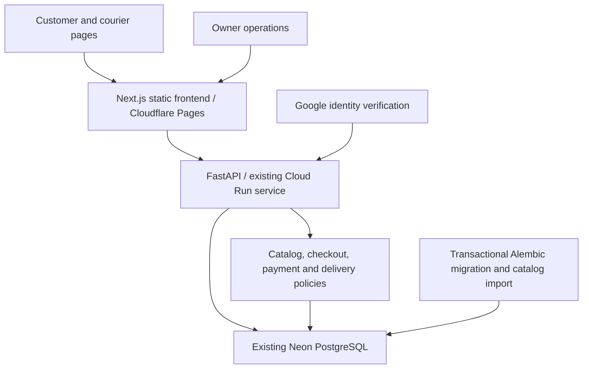
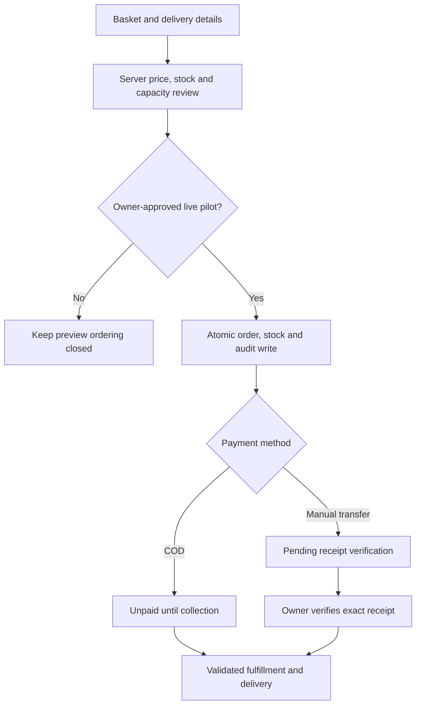

# TRIPPY Delivery

A Bangladesh grocery and parcel delivery platform with bilingual catalog content, Google identities, persistent customer records, owner operations and a controlled path to a Dhaka pilot.

[Website](https://trippy-delivery.pages.dev/) · [Grocery market](https://trippy-delivery.pages.dev/groceries) · [Customer account](https://trippy-delivery.pages.dev/account) · [Owner dashboard](https://trippy-delivery.pages.dev/admin) · [Operating guide](docs/COMMERCE_OPERATIONS.md) · [Pilot readiness](docs/PILOT_READINESS.md)

> **Preview release. Real customer orders and fulfillment remain closed.** Catalog content is not verified inventory; prices and stock require owner approval. Payment gateways are not enabled, and manual payments are never automatically marked paid.

## Capabilities

| Service | Implemented behavior |
| --- | --- |
| Grocery catalog | 111 versioned Bangladesh product records, English/Bengali names, departments, search, sorting, descriptions, seasonal notes, units and owner-editable content |
| Fresh preparation | Per-product enabled choices, preparation fees, quantity increments, yield estimates and images where available |
| Basket and checkout | Browser basket, account-saved basket, delivery address, server-calculated prices/fees/offers, transactional stock reservation and customer-scoped idempotency |
| Manual payments | Configurable bKash, Nagad, Rocket, bank transfer and COD; verified receiving-detail gates and separate payment/fulfillment states |
| Fulfillment | Review, confirmation, preparation, packing, verified courier assignment, delivery, rejection, failure and refund-required handling |
| Parcels | Persistent bookings, dimension/weight quotations, owner assignment, scoped courier updates and tracking events; distance is estimated, not live road routing |
| Owner operations | Product/stock editing, preparation configuration, zones/capacity, receiving accounts, promotions, support announcements, partner review, masked customer listings and audit events |
| Customer and courier access | Verified Google identity, private histories, partner applications and assigned-work authorization; applications never auto-approve |

The catalog importer sets **zero stock, zero selling price and no price approval**. Existing owner edits are preserved on every import. Some products still need approved photographs; the repository does not claim newly verified image rights.

## Architecture



Frontend and backend remain separate deployments. The frontend never receives the database secret. PostgreSQL owns profiles, catalog content, grocery/parcel records, stock, settings, approvals and audit history.



## Quick start

Requirements: Python 3.12+, Node.js 22+, and an existing PostgreSQL database for migration/concurrency verification. SQLite-backed unit tests use isolated fixtures and do not require a new database service.

```bash
git clone https://github.com/hossain0707/Trippy-Delivery-.git
cd Trippy-Delivery-
python -m venv .venv
. .venv/bin/activate
pip install -e 'services/api[dev]'
pytest -q services/api/tests
cd apps/web
npm ci --ignore-scripts
npm test
npm run lint
npm run build
```

For local API development, set `APP_ENV=local` and configure the existing development database through environment variables. Local development identity headers are allowed only when explicitly enabled in local/test environments. Hosted environments reject them. Never use sample credentials in a hosted service.

```bash
cd services/api
alembic upgrade head
PYTHONPATH=. python scripts/import_catalog.py
uvicorn app.main:app --host 127.0.0.1 --port 8000
```

Set `NEXT_PUBLIC_API_BASE_URL` to the intended backend and `NEXT_PUBLIC_GOOGLE_CLIENT_ID` to the same Google Web client configured in the backend. See [.env.example](.env.example). Receiving accounts and delivery zones are configured through owner APIs/pages, not frontend source code.

## Interface map

| Customer or operator need | Entry point |
| --- | --- |
| Browse / product detail | `/groceries`, `/product?sku=...` |
| Basket / checkout | `/cart` |
| Account / order tracking | `/account`, `/orders?id=...` |
| Parcel quote / booking | `/parcels` |
| Partner application / history | `/courier` |
| Support and delivery rules | `/support` |
| Owner operations | `/admin` |
| Readiness / deployed revision | `/health/ready`, `/health/live` on the API |

All privileged actions are checked by backend dependencies. Receiving details cannot be enabled with unverified or all-zero accounts. Recording a transfer reference does not confirm payment; simulated confirmation is restricted to the isolated `test` environment and produces `test_paid`.

## Development and release

GitHub Actions runs backend tests, frontend unit tests, lint and the production build. The existing Cloud Build trigger and Cloudflare Pages integration deploy `main`. Backend startup serializes additive migrations and schema validation with a PostgreSQL advisory transaction lock, then imports only missing catalog rows before serving traffic. A failed migration prevents the new revision becoming ready.

Keep `APP_ENV=preview`, `LIVE_ORDERS_ENABLED=false`, `PILOT_APPROVED=false` and `ALLOW_DEV_AUTH=false` for the public preview. A separately approved non-preview pilot requires both live flags and verified operational configuration. Preview remains closed even if the flags are set accidentally.

- [Commerce operating, import, deployment and rollback instructions](docs/COMMERCE_OPERATIONS.md)
- [Pilot GO / NO-GO checklist](docs/PILOT_READINESS.md)
- [QA evidence and verification limits](docs/COMMERCE_QA.md)

## Verification and limits

The automated suite covers Google token validation, owner/customer isolation, basket persistence, inventory rollback, idempotency, payment verification, COD restrictions, delivery schedules/capacity, courier eligibility and order transitions. Optional PostgreSQL concurrency tests create and remove uniquely named temporary schemas when `TRIPPY_TEST_DATABASE_URL` is supplied. Skipped tests are not reported as passing.

No live routing, traffic feed, GPS integration, automated payment gateway, financial reconciliation ledger or identity-document hosting is claimed. Existing image provenance, missing photographs, actual inventory/prices, receiving accounts, operational staff/coverage, backup restoration and final owner approval must be verified before commercial launch. Software readiness and operating readiness are separate gates.

## Ownership

Engineering and documentation: **Md Najmul Hossain** ([hossain0707](https://github.com/hossain0707)). This repository retains the existing **TRIPPY project proprietary / All Rights Reserved** terms in [LICENSE](LICENSE). Public visibility does not grant reuse or commercial deployment permission.
