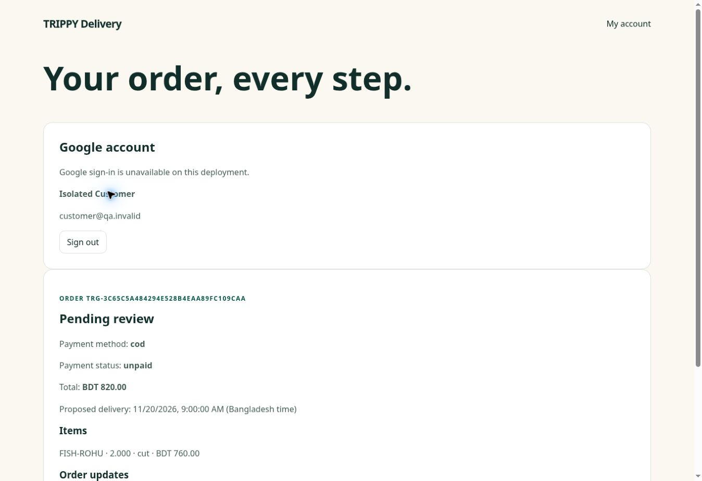

# Commerce QA record

## Verified locally

84 backend tests pass; two optional PostgreSQL concurrency tests skip. Six frontend unit tests pass. TypeScript and the production build pass. ESLint has no errors and five image-optimization warnings.

- 111 product catalog entries validate and import idempotently; imported records cannot silently create approved prices or stock.
- Backend regression tests include COD, manual transfers, unauthorized receipt confirmation, amount mismatch, duplicate receipts, preparation fees/increments, case-insensitive slot capacity, restocking/refund-required states, Google claims and owner isolation.
- Frontend unit tests cover basket preparation totals and editable-profile payload isolation.
- Frontend TypeScript checks, lint and static production build are executed during development and in GitHub Actions.
- PostgreSQL migration SQL generation is validated. Actual deployed schema readiness must be checked after the existing pipeline runs.

## Controlled browser records

The separate internal QA process uses temporary SQLite data and explicit fake customer/owner identities. A two-kilogram prepared Rohu basket produced an item subtotal of ৳760, a configured delivery fee of ৳60, and a server-reviewed total of ৳820. Submitting COD created a persistent order, cleared the basket and opened customer tracking with payment **unpaid** and fulfillment **pending review**. No real receiving account, transfer or dispatch was used.

A timezone inconsistency observed in SQLite-backed tracking was fixed by explicitly serializing Bangladesh delivery time and UTC event time. Real PostgreSQL timezone-aware values are preserved.

## Verification limits

Two optional PostgreSQL concurrency tests skip without an explicitly supplied existing test connection. They must be run against isolated schemas before a commercial pilot. Browser automation and viewport support depend on the connected environment; record mobile/tablet/desktop dimensions and results only when they are actually observed. Do not convert a successful build or desktop screenshot into a mobile-pass claim.

Image accuracy and rights have not been independently reverified. Existing repository assets are reused where available; missing images remain visibly pending. Real inventory, suppliers, verified prices, support contacts, receiving destinations, courier documentation and operating capacity are not fabricated test data.
